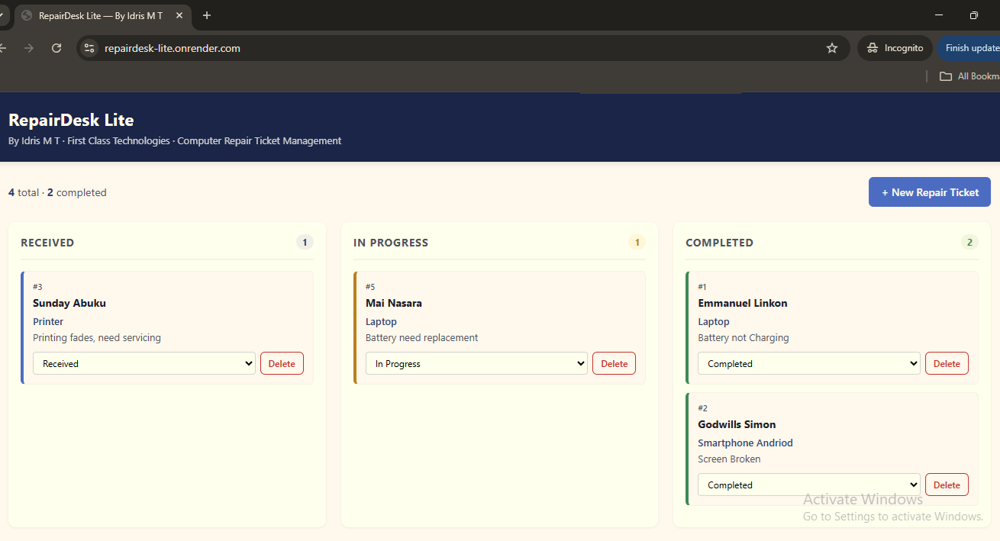

# RepairDesk Lite

> A repair ticket management system for computer repair shops — track jobs from intake to completion on a simple Kanban board.

🔗 **Live Demo:** https://repairdesk-lite.onrender.com



---

## About

RepairDesk Lite is a lightweight REST API + web UI for managing computer repair tickets. It was built to solve a real problem: small repair shops tracking jobs in notebooks or WhatsApp messages, with no visibility into what's received, in progress, or completed.

The system handles the full ticket lifecycle — from intake through completion — with persistent storage, input validation, and a clean interface that works on desktop and mobile.

## Features

- **Full CRUD** on repair tickets (create, list, view, update status, delete)
- **Kanban board UI** with three stages: Received → In Progress → Completed
- **Persistent storage** with SQLite (WAL mode for durability)
- **Input validation** and request size limits
- **Strict TypeScript** throughout — no `any`, no `@ts-ignore`
- **Zero frontend dependencies** — vanilla HTML/CSS/JS, no build step
- **Same-origin deployment** — the API and UI are served by the same Node process

## Tech Stack

| Layer | Technology |
|---|---|
| Runtime | Node.js |
| Language | TypeScript (strict mode) |
| HTTP Server | Node's built-in `http` module (no framework) |
| Database | SQLite via `better-sqlite3` |
| Frontend | Vanilla HTML / CSS / JavaScript |
| Dev Runner | `tsx` (fast TypeScript execution with watch mode) |
| Hosting | Render (free tier) |

## API Reference

| Method | Endpoint | Description |
|---|---|---|
| `GET`    | `/health`              | Health check |
| `GET`    | `/api/repairs`         | List all repair tickets |
| `GET`    | `/api/repairs/:id`     | Get a single ticket |
| `POST`   | `/api/repairs`         | Create a new ticket |
| `PATCH`  | `/api/repairs/:id`     | Update ticket status |
| `DELETE` | `/api/repairs/:id`     | Delete a ticket |

### Example requests

**Create a ticket:**

```bash
curl -X POST https://repairdesk-lite.onrender.com/api/repairs \
  -H "Content-Type: application/json" \
  -d '{"customerName":"John Doe","device":"Laptop","issue":"Battery not charging"}'
